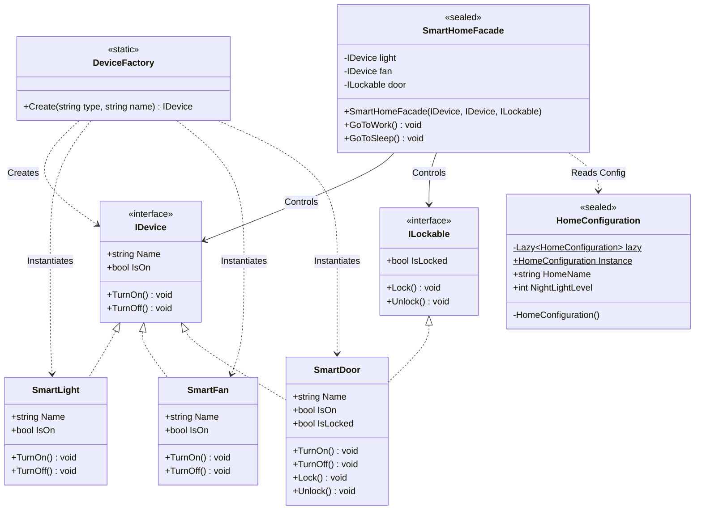

# BÀI THỰC HÀNH 10: SMART HOME MINI (OOP - W9)

> **Thông tin sinh viên:**
> - **Họ và tên:** Hoàng Đình Duy
> - **Mã sinh viên:** 202418887
> - **Lớp:** OOP

---

## 1. Tổng quan hệ thống & Danh mục lớp

Dự án xây dựng mô hình điều khiển Ngôi nhà thông minh thu nhỏ (**Smart Home Mini**) áp dụng 3 Design Patterns kinh điển: **Factory Pattern**, **Singleton Pattern**, và **Facade Pattern**.

### Danh sách các file mã nguồn:
- [IDevice.cs](file:///D:/OOP/W9/IDevice.cs): Giao diện trừu tượng chung cho mọi thiết bị (`TurnOn()`, `TurnOff()`).
- [ILockable.cs](file:///D:/OOP/W9/ILockable.cs): Giao diện riêng cho các thiết bị có chức năng khóa/mở khóa an ninh (`Lock()`, `Unlock()`).
- [SmartLight.cs](file:///D:/OOP/W9/SmartLight.cs): Cài đặt thiết bị Đèn thông minh (thực thi `IDevice`).
- [SmartFan.cs](file:///D:/OOP/W9/SmartFan.cs): Cài đặt thiết bị Quạt thông minh (thực thi `IDevice`).
- [SmartDoor.cs](file:///D:/OOP/W9/SmartDoor.cs): Cài đặt thiết bị Cửa thông minh (thực thi `IDevice`, `ILockable`).
- [DeviceFactory.cs](file:///D:/OOP/W9/DeviceFactory.cs): Factory tạo đối tượng thiết bị dựa trên loại đầu vào.
- [HomeConfiguration.cs](file:///D:/OOP/W9/HomeConfiguration.cs): Singleton quản lý cấu hình duy nhất của ngôi nhà.
- [SmartHomeFacade.cs](file:///D:/OOP/W9/SmartHomeFacade.cs): Facade cung cấp kịch bản mức cao (`GoToWork()`, `GoToSleep()`).
- [TestSuite.cs](file:///D:/OOP/W9/TestSuite.cs): Bộ kiểm thử tự động kịch bản từ **T1 đến T6**.
- [Program.cs](file:///D:/OOP/W9/Program.cs): Giao diện dòng lệnh Console tương tác tự nhập kiểm thử và menu điều khiển.

---

## 2. Sơ đồ lớp (Class Diagram)

---

## 3. Vị trí sử dụng & Lợi ích của từng Pattern

### 3.1. Factory Pattern
- **Vị trí sử dụng:** Nằm tại lớp `DeviceFactory.cs`, phương thức `Create(string type, string name)`.
- **Lợi ích đạt được:**
  - Che giấu hoàn toàn các lớp cụ thể (`SmartLight`, `SmartFan`, `SmartDoor`) khỏi client.
  - Client chỉ cần làm việc với giao diện trừu tượng `IDevice`.
  - Chuẩn hóa quy trình tạo đối tượng; client không phải gọi trực tiếp từ khóa `new`.

### 3.2. Singleton Pattern
- **Vị trí sử dụng:** Lớp `HomeConfiguration.cs`, thông qua thuộc tính tĩnh `HomeConfiguration.Instance`.
- **Lợi ích đạt được:**
  - Đảm bảo ứng dụng chỉ có duy nhất **một đối tượng cấu hình** trong suốt vòng đời chạy.
  - Cung cấp điểm truy cập toàn cục nhất quán cho mọi thành phần (Facade, Client,...) truy xuất các thông số như `HomeName`, `NightLightLevel`.

### 3.3. Facade Pattern
- **Vị trí sử dụng:** Lớp `SmartHomeFacade.cs`, thông qua 2 phương thức điều phối mức cao `GoToWork()` và `GoToSleep()`.
- **Lợi ích đạt được:**
  - Gom các thao tác điều khiển phức tạp trên nhiều thiết bị rời rạc (tắt quạt, tắt đèn, khóa cửa, đọc cấu hình sáng) vào một lệnh gọi duy nhất.
  - Giảm sự phụ thuộc (loose coupling) cho client. Khi quy trình bên trong thay đổi, code client không bị xáo trộn.

---

## 4. Một số hạn chế của thiết kế

1. **Vi phạm nguyên lý Open/Closed Principle (OCP) ở Factory:**
   - Trong `DeviceFactory`, việc lựa chọn thiết bị sử dụng cấu trúc `switch-case` theo chuỗi `string`. Khi cần mở rộng thêm thiết bị mới (ví dụ `SmartCamera`), ta bắt buộc phải chỉnh sửa mã nguồn của lớp `DeviceFactory`.
2. **Khó khăn trong Unit Testing do Singleton:**
   - `HomeConfiguration.Instance` lưu trữ trạng thái toàn cục (global state) và tồn tại suốt vòng đời ứng dụng. Điều này khiến các ca kiểm thử phụ thuộc lẫn nhau, khó chạy song song và khó mock dữ liệu kiểm thử.
3. **Độ cứng nhắc của Facade:**
   - `SmartHomeFacade` hiện tại nhận cứng 3 thiết bị trong constructor (`light`, `fan`, `door`). Nếu ngôi nhà có nhiều đèn hoặc muốn cấu hình kịch bản linh hoạt cho từng phòng thì Facade hiện tại chưa hỗ trợ tốt.

---

## 5. Kịch bản kiểm thử (Test Cases T1 -> T6)

| Mã test | Tình huống kiểm tra | Kết quả mong đợi |
| :---: | :--- | :--- |
| **T1** | Tạo thiết bị hợp lệ (`light`, `fan`, `door`) | Factory trả về đúng kiểu đối tượng `SmartLight`, `SmartFan`, `SmartDoor`. |
| **T2** | Tạo loại thiết bị chưa hỗ trợ (`camera`) | Phát sinh ngoại lệ `ArgumentException`. |
| **T3** | Lấy `HomeConfiguration.Instance` hai lần | Hai biến `c1` và `c2` cùng trỏ đến một vùng nhớ (`ReferenceEquals` trả về `True`). |
| **T4** | Gọi kịch bản `GoToWork()` | Đèn tắt (`OFF`), Quạt tắt (`OFF`), Cửa khóa (`LOCKED`). |
| **T5** | Gọi kịch bản `GoToSleep()` | Quạt tắt (`OFF`), Cửa khóa (`LOCKED`), Đèn bật (`ON`), in mức sáng ban đêm từ cấu hình. |
| **T6** | Cập nhật mức sáng trong Singleton & Xử lý chuỗi hoa/thường | Cấu hình thay đổi được phản ánh đồng bộ vào Facade; Factory chấp nhận chuỗi như `"  LiGhT  "`. |

---

## 6. Trả lời các câu hỏi Phần G

### Câu 1: Factory đang che giấu quyết định thiết kế nào?
> **Trả lời:** Factory che giấu việc **lựa chọn lớp cụ thể nào sẽ được cấp phát** (`SmartLight`, `SmartFan`, hay `SmartDoor`) và logic khởi tạo chi tiết. Client chỉ gửi vào yêu cầu trừu tượng (tên loại) và nhận về abstraction `IDevice`, không cần biết cấu trúc bên dưới.

### Câu 2: Singleton bảo đảm điều gì, nhưng tạo ra rủi ro nào?
> **Trả lời:**
> - **Bảo đảm:** Đảm bảo duy nhất một thể hiện của lớp tồn tại trong toàn bộ ứng dụng và cung cấp một điểm truy cập toàn cục tới thể hiện đó.
> - **Rủi ro:** Tạo ra biến toàn cục (global state), làm tăng độ ghép nối ẩn, gây khó khăn cho Unit Test (khó reset trạng thái giữa các bài test) và có nguy cơ lỗi đa luồng (concurrency) nếu không xử lý thread-safe.

### Câu 3: Facade khác Factory ở mục đích chính như thế nào?
> **Trả lời:**
> - **Factory** là *Creational Pattern* (mẫu khởi tạo): Mục đích chính là đóng gói và tách rời **việc tạo đối tượng**.
> - **Facade** là *Structural Pattern* (mẫu cấu trúc): Mục đích chính là cung cấp **giao diện cấp cao đơn giản hóa** để điều phối và che giấu sự phức tạp của một hệ thống con gồm nhiều đối tượng tương tác với nhau.

### Câu 4: Nếu bỏ SmartHomeFacade, client sẽ phải biết thêm những chi tiết nào?
> **Trả lời:** Client sẽ phải:
> 1. Trực tiếp nắm giữ tham chiếu đến từng thiết bị cụ thể (`IDevice`, `ILockable`).
> 2. Tự ghi nhớ và quản lý đúng trình tự các bước thực hiện (ví dụ: khi đi làm phải tắt thiết bị nào trước, khóa cửa ở bước nào).
> 3. Tự truy cập vào `HomeConfiguration` để đọc thông số cấu hình và áp dụng cho các thiết bị.
> -> Dẫn đến code client bị phình to, lặp lại và phụ thuộc chặt chẽ (tight coupling) vào hệ thống con.

